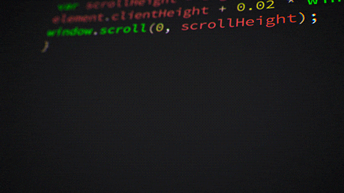
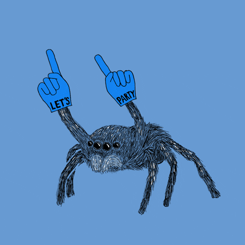
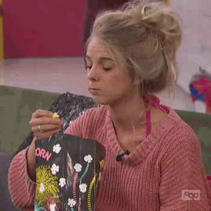
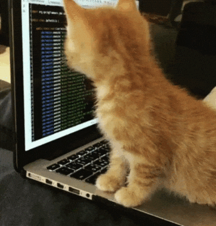

<!-- TERMINAL BOOT SEQUENCE -->

 

<!-- HACKER TERMINAL GIF -->

 

<!-- MATRIX RAIN DIVIDER -->

 

 

 

<!-- ROLE BADGES — DARK HACKER STYLE -->

  

<!-- STATS BADGES -->

  

 

<!-- ABOUT — WAR CHEST -->

## 🩸 [ OPERATOR PROFILE ]

<table align="center">
<tr>
<td width="100%" align="center">

 

> **BLOODRAVENIST** — **Offensive Security Engineer & Red Teamer**
> 
> *"I don't run scripts. I weaponize them."*
> 
> *"I don't find bugs. I hunt them."*
> 
> *"I don't follow paths. I create them."*
> 
> **This isn't a portfolio. It's a war chest.**

</td>
</tr>
</table>

 

 

## 💀 [ OFFENSIVE SKILLS ]

<table align="center">
<tr>
<td width="50%" valign="top">

### 🌐 WEB EXPLOITATION

- SQL Injection (Error / Blind / Time-based)
- XSS (Reflected / Stored / DOM)
- IDOR / Broken Access Control
- SSRF / CSRF / XXE
- File Upload → RCE
- Auth & Session Bypass

### 🔐 NETWORK & INFRA

- Port Scanning & Enumeration
- SMB / LDAP / Kerberos
- NTLM Relay & Pass-the-Hash
- MITM & Traffic Analysis

</td>
<td width="50%" valign="top">

### 🏰 ACTIVE DIRECTORY

- BloodHound / PowerView
- Kerberoasting / AS-REP
- LSASS Dumping
- PrivEsc (Linux / Windows)
- Lateral Movement

### ⚔️ RED TEAM OPS

- Reconnaissance & OSINT
- Exploit Dev (C / Python)
- Buffer Overflow
- Custom Tooling
- CTF & Real-World

</td>
</tr>
</table>

 

 

## 🏆 [ CERTIFICATIONS ]

<table align="center">
<tr>
<td width="50%" valign="top">

### 🎯 OFFENSIVE SECURITY

</td>
<td width="50%" valign="top">

### 🛡️ ADDITIONAL

</td>
</tr>
</table>

 

 

## 🗡️ [ WEAPONS OF CHOICE ]

<table align="center">
<tr>
<td width="100%">

| 🌐 **WEB** | 🔐 **NETWORK** | 🏰 **AD / RED TEAM** | 💻 **DEV** |
|---|---|---|---|
| Burp Suite Pro | Nmap / Rustscan | BloodHound | Python 3 |
| SQLmap | Wireshark | Impacket | Bash |
| FFuf / Gobuster | Metasploit | Mimikatz | C / C++ |
| Nuclei | Responder | CrackMapExec | SQL |
| XSStrike | Hydra / Medusa | Rubeus / Certipy | HTML/CSS/JS |

</td>
</tr>
</table>

 

 

## 🔥 [ ARSENAL — PROJECTS ]

<table align="center">
<tr>
<td width="50%" valign="top">

### 🩸 [FTBUGRECON](https://github.com/BLOODRAVENIST/FTBUGRECON)

**God of Bug Bounty Recon** — 500+ tools in C with purple banner.

</td>
<td width="50%" valign="top">

### 💀 [FTWEBRC](https://github.com/BLOODRAVENIST/FTWEBRC)

**God of Bug Bounty Enumeration** — 75+ tools, pure C.

</td>
</tr>
<tr>
<td width="50%" valign="top">

### 🤖 [FTRIYANA](https://github.com/BLOODRAVENIST/FTRIYANA)

**Deep Internal Recon Framework** — AI-driven pentesting.

</td>
<td width="50%" valign="top">

### 🌐 [FTJIYANA](https://github.com/BLOODRAVENIST/FTJIYANA)

**External Web Pentesting Framework** — 40+ tools, 19 phases.

</td>
</tr>
<tr>
<td width="50%" valign="top">

### 👻 [FTLAMBDA](https://github.com/BLOODRAVENIST/FTLAMBDA)

**Ultimate Pentest Lab Generator** — 300+ dirs, pure C.

</td>
<td width="50%" valign="top">

### 🖥️ [FTWEB_X](https://github.com/BLOODRAVENIST/FTWEB_X)

**Web GUI for FTBUGRECON** — 500+ bug bounty tools.

</td>
</tr>
</table>

 

 

## 📊 [ GITHUB OPERATIONS ]

 

 

## 🐍 [ CONTRIBUTION SNAKE ]

 

## 🎯 [ ACTIVITY GRAPH ]

 

 

## 💀 [ PHILOSOPHY ]

<table align="center">
<tr>
<td width="100%" align="center">

> *"Recon is not about tools. It's about seeing what others don't."*

> *"Every system has a weakness. My job is to find it — before someone else does."*

> *"Exploits aren't written. They're discovered."*

> *"The quieter you become, the more you are able to hear."* — **Kali**

</td>
</tr>
</table>

 

## ⚖️ [ LEGAL ]

> **🚨 ALL RESEARCH IS FOR AUTHORIZED OFFENSIVE SECURITY ONLY 🚨**

**Authorized bug bounty scopes** · **Lab environments** · **Written-permission pentests**

**Unauthorized access is illegal under CFAA, Computer Misuse Act, IT Act, and similar laws worldwide.**

 

 

## 🩸 [ CONNECT ]

  

### ⭐ **If my work helped you — give it a star** ⭐

 

 

 

 

